# 🍽️ Sachivalay Canteen

A digital food ordering and canteen management solution developed for the **Gujarat Government SSIP Hackathon**.

The system was designed to digitize the traditional canteen ordering process at Sachivalay by connecting an employee-facing mobile application, a canteen manager web portal, and an admin dashboard through a centralized backend.

> 🧑‍🤝‍🧑 **Team project** — this repository was forked from a teammate's original submission repo.  
> I was responsible for **backend development and building the REST APIs using Node.js and Express.js**; see [My Contribution](#-my-contribution) below for full details.

> 🏆 **1st Prize — Gujarat Government SSIP Hackathon**
>
> Selected as the winning team among **2,500+ teams across Gujarat**.

---

## 🎯 Problem Statement

### Online Order Canteen System

Traditional canteen operations involved manual ordering, paper-based bills, and maintaining physical records.

The proposed system aimed to digitize these operations by allowing employees to order food through a mobile application while providing dedicated web interfaces for canteen managers and administrators—all powered by a unified backend API layer.

The complete system consisted of three major entities:

- 👨‍💼 **Employee** — Mobile application
- 🍽️ **Canteen Manager** — Web application
- 🛠️ **Admin** — Web application

---

## 💡 Solution

The solution connects employees, the canteen, and administrators through a centralized digital system backed by modular REST APIs.

### Backend & API Layer (Node.js & Express.js)

The backend powers all three client interfaces by handling:

- 🔐 Role-based authentication and session management (`auth`)
- 👤 Employee profile, favourite orders, and feedback management (`user`)
- 🍽️ Food catalogue, menu availability, search, and ratings (`canteen`)
- 📦 Order creation, live order tracking, and order history (`canteen` & `user`)
- 💰 Digital wallet balance checks, deductions, and transaction logs (`payment`)
- 💳 Online payment workflow integration when wallet balance is insufficient (`payment`)
- 🛠️ Employee registration, revenue tracking, and canteen monitoring (`admin`)

### Employee Mobile Application

Employees can:

- 🔐 Log in to the application
- 🍽️ Browse the digital food menu
- 🔎 Search for dishes
- ⭐ View food details and ratings
- 🛒 Select quantities and add items to the basket
- 📦 Place food orders
- 💰 Use their digital wallet
- 💳 Make online payments when required
- 📜 View order history
- ❤️ Manage favourite orders
- 🔔 Access notifications
- 👤 Manage their profile
- 💬 Provide feedback

### Canteen Management

The wider system allows the canteen manager to:

- Add new food items
- Modify existing food items
- Delete food items
- View current orders
- View order history
- Manage wallet information
- Track revenue

### Administration

The admin side provides management capabilities including employee registration and monitoring of the canteen operation.

---

# 🏗️ Overall System Architecture

The complete project consisted of an employee mobile application and web-based modules for canteen management and administration, all communicating with a centralized Node.js & Express.js API layer.

```text
                         Sachivalay Canteen System
                                  │
              ┌───────────────────┼───────────────────┐
              │                   │                   │
              ▼                   ▼                   ▼
          Employee          Canteen Manager         Admin
              │                   │                   │
              ▼                   ▼                   ▼
       React Native App       Web Application      Web Application
              │                   │                   │
              └───────────────────┼───────────────────┘
                                  │
                                  ▼
                    Backend REST APIs (Node.js / Express.js)
                                  │
                                  ▼
                         Database (MongoDB)
```

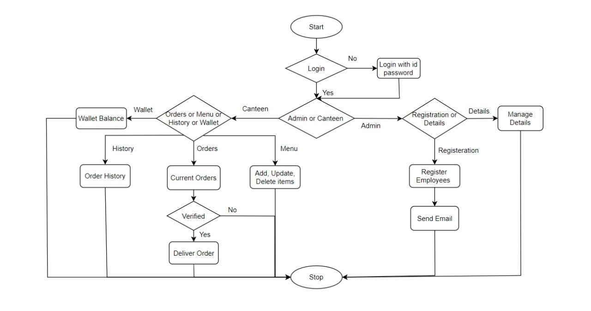

---

# ⚙️ Backend Modules & API Responsibilities

The backend was structured into modular components to cleanly separate business logic across system domains:

| Module | Directory | Core API Responsibilities |
| :--- | :--- | :--- |
| **Authentication** | `auth/` | User login, credential verification, and access control across Employee, Canteen Manager, and Admin roles |
| **User** | `user/` | Employee profile management, order history retrieval, favourite orders, notifications, and feedback |
| **Canteen** | `canteen/` | Menu CRUD operations, item availability, food ratings, active order processing, and sales/revenue data |
| **Payment** | `payment/` | Digital wallet balance validation, wallet deductions, transaction history, and online payment flow |
| **Admin** | `admin/` | Employee registration, account management, and system-wide canteen monitoring |

---

# 📱 Application Preview

The backend APIs power the employee-facing **React Native** mobile application and the **React.js** web dashboards.

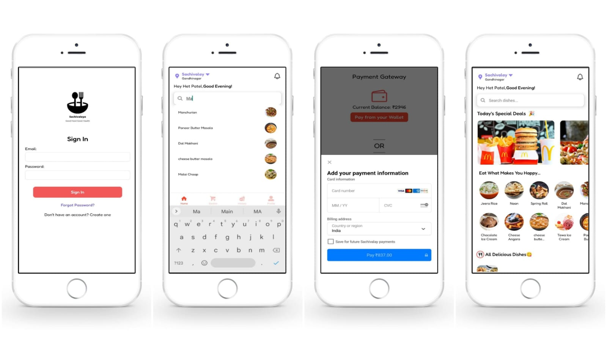

## 🏠 Home & Food Discovery

The home screen fetches live menu categories, special deals, food items, and notifications from the backend:

- 📍 Location information
- 🔎 Search
- 🎉 Special deals
- 🍴 Food categories
- 🍕 Food items
- 🔔 Notifications
- Navigation to different sections of the application

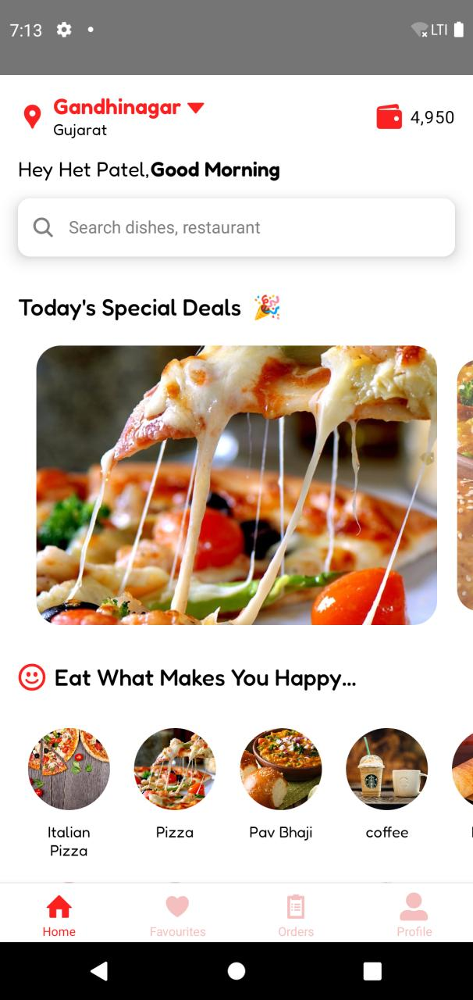

### Alternative Home Screen

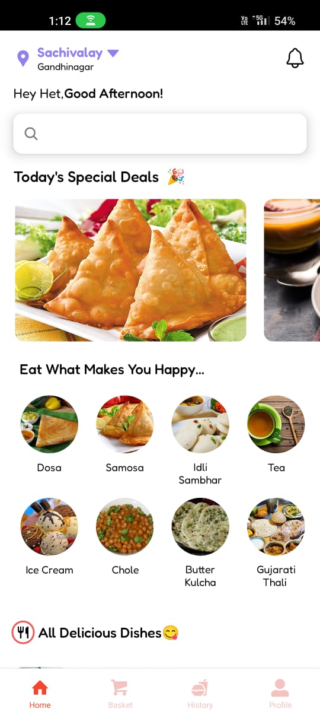

---

## 🍕 Food Menu

Employees can browse available dishes served via the canteen APIs along with:

- Food category
- Vegetarian/non-vegetarian indicator
- Ratings & number of ratings
- Price & availability
- Add-to-basket controls

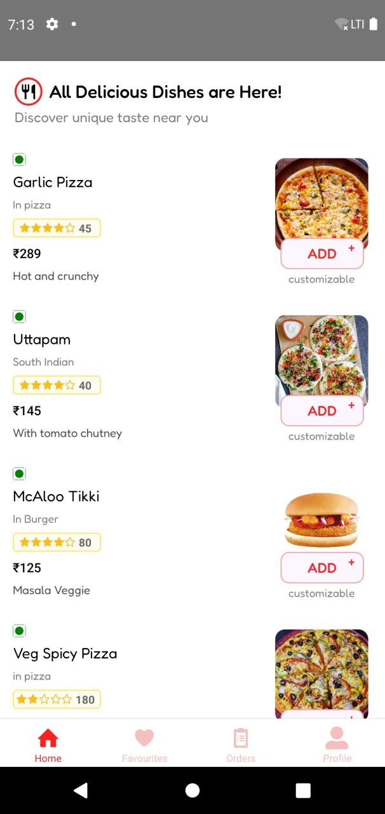

### Detailed Food Listing

The application also distinguishes unavailable food items from available items while displaying their prices and ratings.

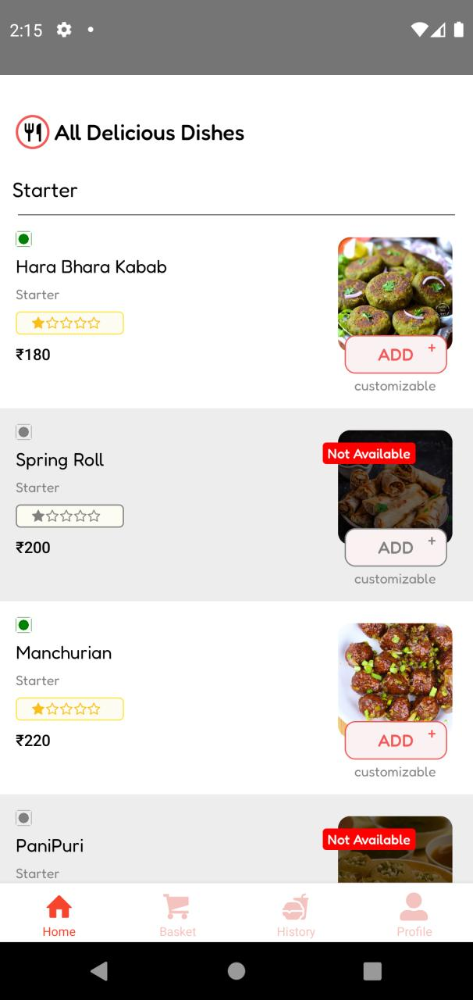

---

## 🍔 Food Details

Each food item has a dedicated details screen displaying its rating, preparation time, category, and dietary information, allowing employees to select quantities before adding to their basket.

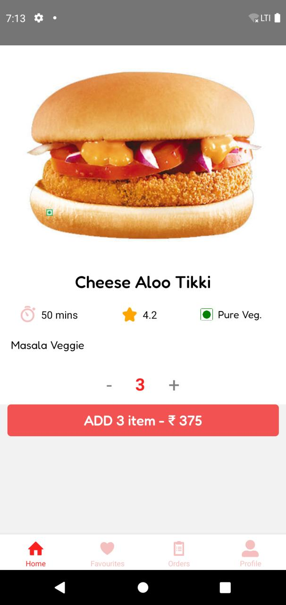

---

## 🛒 Basket & Order Creation

The basket displays selected food items, quantities, individual prices, and the total order amount before submitting the order to the backend for processing.

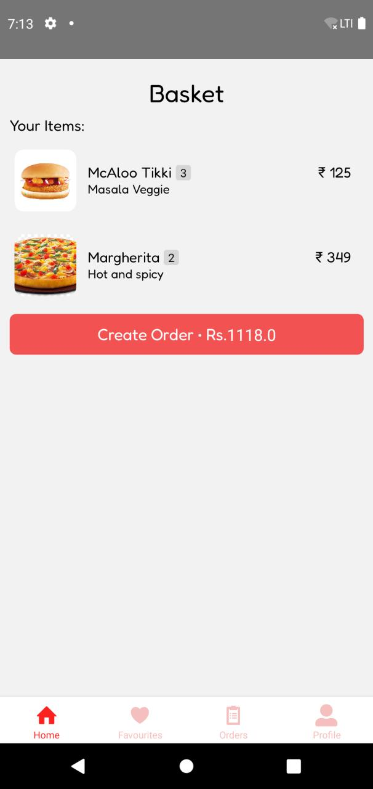

---

# 💳 Payment & Digital Wallet

The backend supports a dual payment workflow combining an internal digital wallet with an online payment fallback.

Employees can view their current wallet balance and pay directly from it when sufficient funds are available; otherwise, the flow routes to online payment.


### Payment Flow

```text
Select Food
     ↓
Add to Basket
     ↓
Create Order
     ↓
Check Wallet Balance
     │
     ├── Sufficient Balance
     │        ↓
     │    Pay from Wallet
     │
     └── Insufficient Balance
              ↓
        Online Payment
              ↓
        Order Processing
              ↓
         Notification
```

### Online Payment

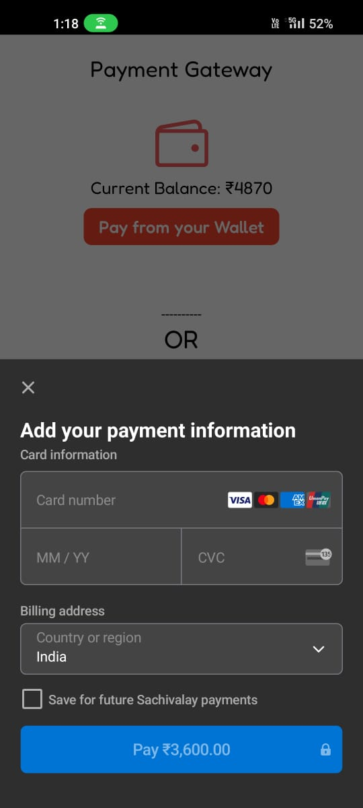

---

# 👤 Profile & Account Management

The profile section connects to the user and payment APIs to provide:

- Employee information
- Wallet balance & transaction history
- Notifications & settings
- Food orders & favourite orders
- Feedback, About section, and Logout

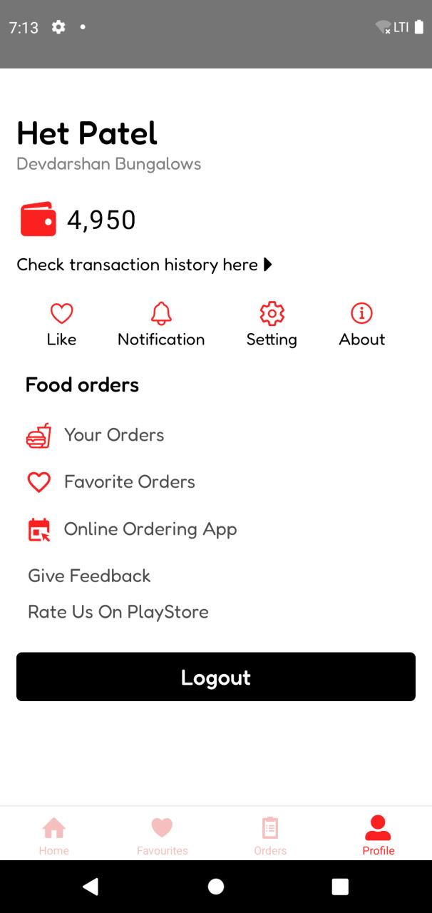

---

# 🔄 Employee Workflow

```text
Start
  ↓
Login
  ↓
┌─────────────────────────────┐
│ Order / Wallet / History    │
└─────────────────────────────┘
  │
  ├── Wallet → View Balance
  │
  ├── History → View Orders
  │
  └── Order
        ↓
     Select Food
        ↓
     Make Order
        ↓
   Check Wallet Balance
        │
        ├── Sufficient
        │       ↓
        │   Pay from Wallet
        │
        └── Insufficient
                ↓
          Online Payment
                ↓
          Notification
                ↓
           Food Rating
                ↓
               Stop
```

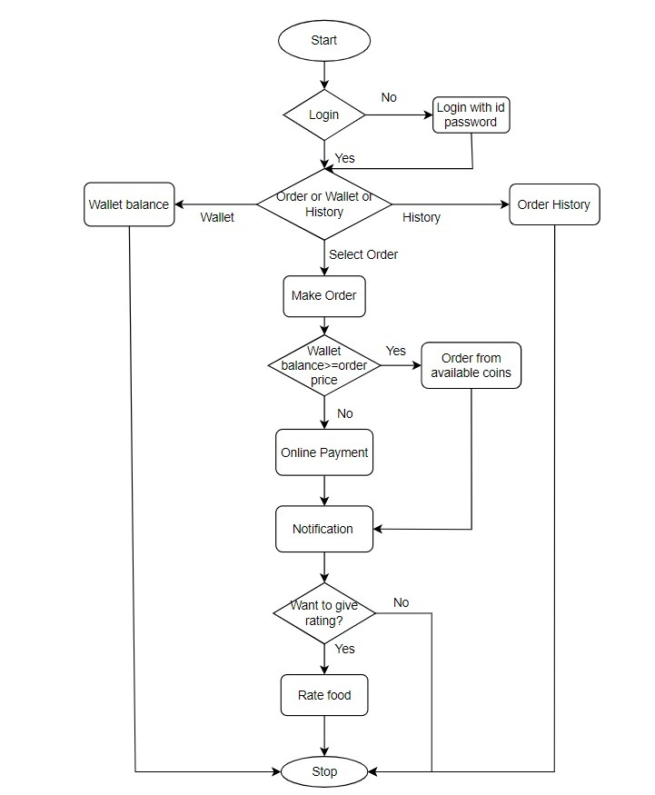

---

# 🖥️ Canteen Management & 🔐 Authentication

### Canteen Dashboard
The web interface for canteen management consumes the canteen and payment APIs to provide an overview of users, incoming orders, wallet information, sales, and revenue trends.

### Authentication
Employees sign in through the authentication flow backed by the `auth` module.


---

# 🛠️ Technology Stack

## Backend (My Focus)

- **Node.js** — Backend runtime environment
- **Express.js** — RESTful API framework and routing
- **MongoDB** — NoSQL database for users, menu items, orders, and wallet records
- **AWS** — Backend infrastructure and hosting

## Frontend Clients (Team Modules)

- **React Native** — Employee mobile application (React Navigation, Axios, AsyncStorage, React Hook Form, Stripe React Native, Lottie)
- **React.js** — Canteen Manager and Admin web applications

---

# 🧩 Key Features

## Backend & Canteen Operations

- 🔐 Role-based authentication & user management
- 🍴 Menu & food catalogue APIs (add, update, delete, availability)
- 📋 Order lifecycle & real-time order management
- 💰 Digital wallet management & balance validation
- 💳 Online payment integration
- 📊 Sales & revenue analytics data
- 📜 Order & transaction history

## Employee Mobile App

- 🍽️ Digital food menu & search
- 🎉 Special deals, food categories, and ratings
- 🛒 Basket management & food ordering
- ❤️ Favourite orders, notifications, profile, and feedback

---

# 🚀 Project Outcome

The project was developed as a solution to a real-world government canteen digitization problem.

The employee application was released through **Google Play** during the project period and received positive feedback during its release.

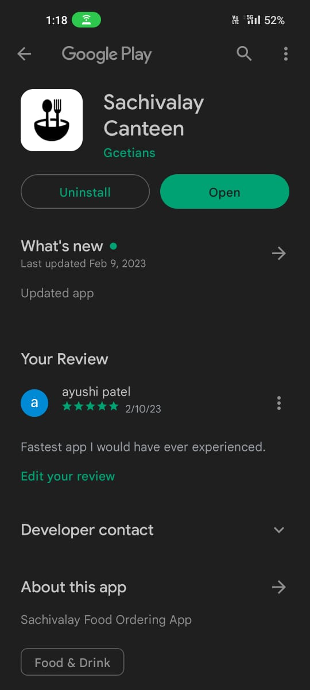

---

# 🏆 Recognition

## Gujarat Government SSIP Hackathon — 🥇 1st Prize

The project was selected as the winning solution among **2,500+ participating teams across Gujarat**, focused on digitizing canteen operations and simplifying food ordering for government employees.

---

# 👨‍💻 My Contribution

I primarily worked on the **backend development and REST APIs** using **Node.js** and **Express.js**.

My work included:

- Designing and developing RESTful APIs using **Node.js** and **Express.js**
- Building modular backend routes and controllers across authentication (`auth`), user management (`user`), canteen operations (`canteen`), payments (`payment`), and administration (`admin`)
- Implementing backend logic for menu browsing, search, item availability, and food ratings
- Developing order creation, order processing, order history, and favourite order endpoints
- Implementing digital wallet balance verification, transaction tracking, and online payment workflow APIs
- Designing data models and integrating the APIs with **MongoDB**
- Collaborating with the mobile (React Native) and web (React.js) frontend teammates to integrate and test API endpoints
- Contributing to the overall system architecture and project delivery

---

# 📚 Project Background

**Project:** Sachivalay Canteen — Online Order Canteen System  
**Program:** Gujarat Government SSIP Hackathon  
**Duration:** January 2023 – March 2023  
**Role:** Backend Development (REST APIs)  
**Primary Technology:** Node.js, Express.js  
**Recognition:** 1st Prize among 2,500+ teams across Gujarat

---

# 📁 Project Structure

The repository contains the original project modules, including the Node.js/Express.js backend services alongside the employee mobile application and web modules developed as part of the complete SSIP solution.

```text
ssip/
│
├── auth/                # Authentication backend module (Node.js / Express.js)
├── user/                # User & order history backend module
├── canteen/             # Canteen & menu management backend module
├── payment/             # Digital wallet & payment backend module
├── admin/               # Administration module
├── django/              # Additional backend project components
├── UserMobile/          # Employee React Native application
├── Website Module/      # Web application (Canteen Manager & Admin)
│
├── screenshots/
│   ├── mobile/
│   └── architecture/
│
└── README.md
```

---

# 📸 Additional Application Screenshots

### Home — Alternative UI


### Food Listing


### Food Details


### Basket


### Profile


### Payment

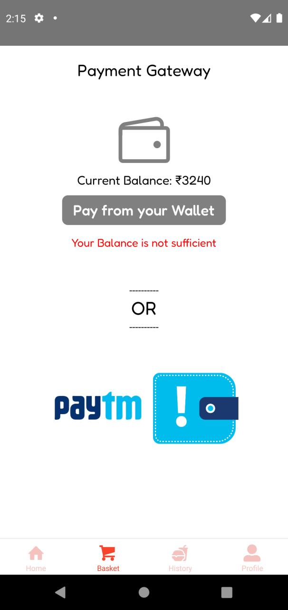

---

# 🏆 From Problem Statement to Product

```text
Government Canteen Problem
          ↓
      SSIP Hackathon
          ↓
     System Design
          ↓
 Node.js & Express.js REST APIs
          ↓
 React Native App & Web Portals
          ↓
 Food Discovery, Ordering & Wallet
          ↓
    Working Product
          ↓
   🥇 1st Prize
```

---

## 📂 Screenshot Files

The README references the following screenshots:

```text
screenshots/
├── app-overview.jpg
├── sign-in.jpg
├── home.jpg
├── home-alternative.jpg
├── menu.jpg
├── food-list.jpg
├── food-details.jpg
├── basket.jpg
├── profile.jpg
├── payment.jpg
├── payment-alternative.jpg
├── online-payment.jpg
├── play-store.jpg
├── employee-flow.jpg
├── system-flow.jpg
```